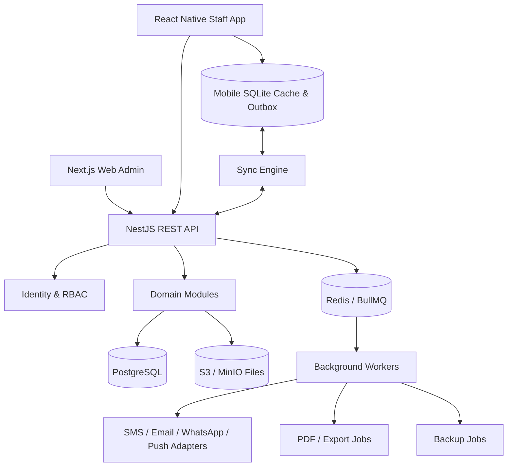

# Architecture

## 1. Architecture principles
- Modular monolith backend first. Avoid premature microservices; preserve clear module boundaries.
- Web and mobile are clients of one versioned API. Domain rules live on server.
- Customer-specific deployment and database by default; multiple branches per customer.
- Offline-first mobile for drafts and queued non-final actions; server is source of truth for finalized clinical/financial/stock state.
- Auditability and transaction integrity are first-class requirements.
- Provider integrations are adapters; no vendor SDK or key leaks into domain modules.

## 2. Logical topology



## 3. Recommended monorepo

```text
vetcore/
  apps/
    web/                  # Next.js clinic back office
    mobile/               # Expo React Native staff app
    api/                  # NestJS modular monolith
    worker/               # BullMQ workers (can share API modules)
  packages/
    contracts/            # DTOs, schemas, generated API types
    domain/               # shared pure domain types/value objects
    ui-tokens/            # design tokens
    config/               # eslint, tsconfig, prettier
  prisma/
    schema.prisma
    migrations/
    seed.ts
  infra/
    docker/
    nginx/
    backup/
  docs/
  tests/
  pnpm-workspace.yaml
  turbo.json
```

## 4. Backend modules
- IdentityModule: auth, sessions, staff, roles, permissions
- ClinicModule: clinic, branch, rooms, settings, numbering
- OwnerModule / PatientModule
- AppointmentModule / FlowboardModule
- ClinicalModule: encounters, SOAP, vitals, diagnoses, files
- CatalogModule: services, products, price lists, tax config
- InventoryModule: warehouses, lots, stock ledger, transfers, counts, alerts
- ProcurementModule: suppliers, purchase orders, receipts, returns
- BillingModule: charges, invoices/document records, payment allocation, refunds
- CashModule: registers, sessions, cash movements
- PrescriptionModule / VaccinationModule
- LaboratoryModule / SurgeryModule / HospitalizationModule
- GroomingModule / BoardingModule (feature flags)
- NotificationModule / IntegrationModule
- ReportingModule / ExportModule / AuditModule / BackupModule

Modules communicate through typed application services/domain events. Avoid cross-module direct table manipulation. Critical stock/finance finalization is an explicit orchestration service with one database transaction.

## 5. Technology stack

| Layer | Recommendation | Notes |
|---|---|---|
| Web | Next.js + React + TypeScript | Server rendering where useful; authenticated dashboard |
| Mobile | Expo React Native + TypeScript | Staff app, camera, push, SQLite |
| Backend | NestJS + TypeScript | Modular monolith, REST/OpenAPI |
| Database | PostgreSQL | Transactions, indexes, constraints |
| ORM | Prisma | Migrations and typed query access; use SQL when locking/ledger needs explicit control |
| Cache/Jobs | Redis + BullMQ | Reminders, exports, PDF, notifications, backup jobs |
| Object storage | S3 compatible / MinIO | Photos, lab documents, PDF, scans |
| Validation | Zod or class-validator | Use consistent API contract strategy |
| Web UI | Tailwind + shadcn/ui | Custom design tokens, accessible primitives |
| Mobile UI | React Native Paper or custom tokenized components | Do not mix visual systems |
| Testing | Vitest/Jest, Supertest, Playwright, Maestro/Detox | Unit, integration, E2E and mobile critical paths |

Do not pin framework versions based on this document. Select supported compatible versions at project kickoff and commit lockfiles.

## 6. API conventions
- Prefix: `/api/v1`
- JSON; ISO 8601 UTC timestamps; clinic-local timezone used for date presentation and appointment rules.
- Cursor pagination for large timelines; page pagination for small admin lists where needed.
- Consistent envelope and problem details; no internal stack traces returned to clients.
- OpenAPI generated and versioned. Mobile app uses typed generated client.
- `Idempotency-Key` for service finalization, payments, refunds, stock adjustments and sync commands.
- Optimistic concurrency with `version` or `updated_at` for mutable drafts.

## 7. Authentication and authorization
- Email/username + password or owner-selected login mode; optional TOTP for privileged roles.
- Short-lived access token + rotating refresh token; secure storage on mobile; HttpOnly secure cookies for web where practical.
- Server-side RBAC + branch scope + resource ownership checks. UI hiding is not authorization.
- Session revocation, brute-force throttling, account lock policy and audit events.

## 8. Mobile offline and sync
- Local SQLite stores minimal cached reference data and unsent drafts/outbox; encrypt sensitive fields/files if supported by platform and threat model.
- Each command has `client_operation_id`, `device_id`, entity version and created timestamp.
- Sync states: local_draft, queued, syncing, synced, conflict, rejected.
- Server acknowledges accepted operations and returns canonical IDs/versions.
- Conflict resolution by domain: clinical note draft can be merged/kept as conflict; finalized clinical record is server-controlled; inventory/finance posting cannot be silently merged offline.
- Never show a queued stock deduction/payment as posted until server confirms.

## 9. Deployment
- Single customer environment: Docker Compose services for API, web, worker, PostgreSQL, Redis, MinIO and reverse proxy.
- Production can use managed PostgreSQL/S3/Redis or self-hosted equivalents.
- TLS at reverse proxy; health/readiness probes; resource limits; log rotation.
- Backup is separate from container lifecycle. Restore drills are mandatory.
- Customer-specific config and branding; no secrets committed to repo.
