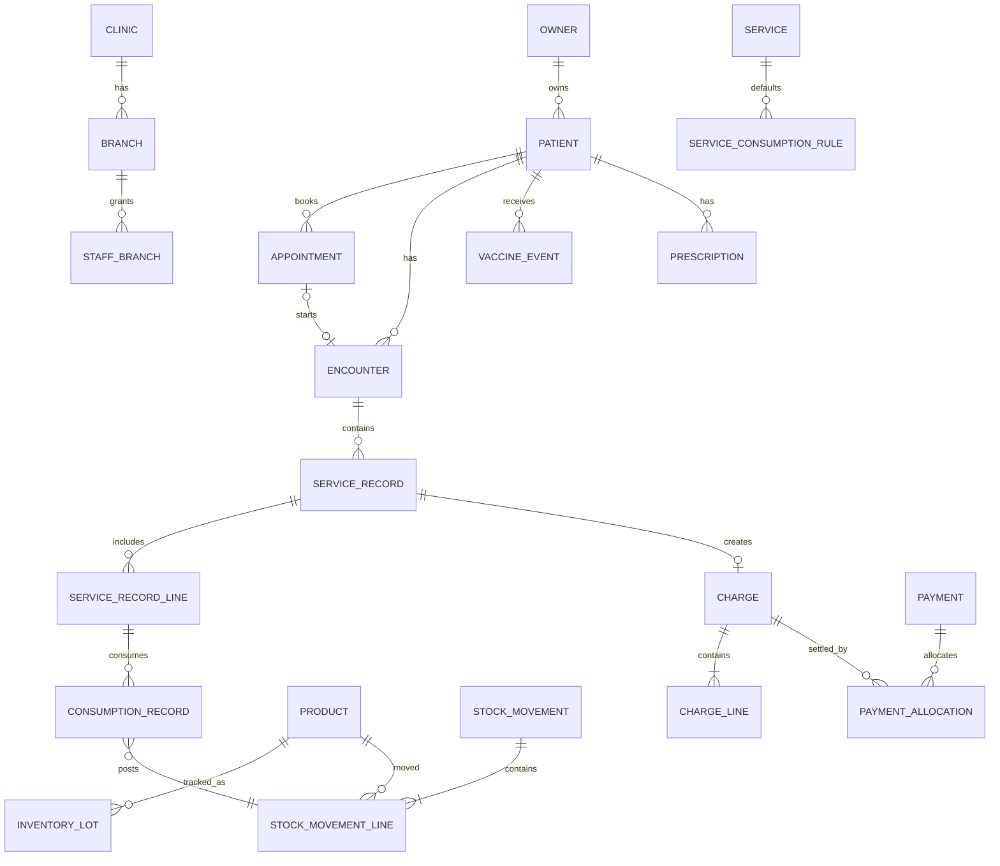

# Data Model (Logical)

## 1. Conventions
- Primary keys: UUID.
- Business tables carry `clinic_id`; branch-specific records also carry `branch_id`.
- Store timestamps as UTC; store clinic timezone in settings.
- Use `created_at`, `updated_at`, `created_by`, `updated_by`, `version` where appropriate.
- Soft delete only for master/reference records where legally and operationally safe. Posted clinical, financial and inventory records are immutable; use void/reversal/addendum.

## 2. Core entities

| Area | Entities | Important relationships |
|---|---|---|
| Clinic | Clinic, Branch, Room, Warehouse, Staff, Role, Permission, StaffBranch | Clinic 1:N Branch; Branch 1:N rooms/warehouses |
| Owner | Owner, OwnerContact, OwnerConsent, OwnerMerge | Owner 1:N Patient; contacts and consent history |
| Patient | Patient, Species, Breed, PatientAlert, WeightObservation, PatientFile | Patient N:1 Owner; patient timeline links visits/events |
| Scheduling | Appointment, AppointmentType, ScheduleBlock, WaitlistEntry | Appointment N:1 Patient, Owner, Staff, Room, Branch |
| Clinical | Encounter, SoapNote, VitalObservation, Diagnosis, ClinicalAttachment, ClinicalAddendum | Encounter N:1 Patient; linked to appointment and veterinarian |
| Catalog | Service, ServicePrice, ServiceConsumptionRule, Product, ProductCategory, Unit, ProductUnitConversion | Service defines default consumption rules |
| Inventory | StockLocation, InventoryLot, StockMovement, StockMovementLine, StockBalance, StockCount, StockTransfer | Ledger lines reference product, location, lot and source entity |
| Procurement | Supplier, PurchaseOrder, PurchaseOrderLine, GoodsReceipt, GoodsReceiptLine, SupplierReturn | Receipt creates stock ledger entries |
| Finance | Charge, ChargeLine, Payment, PaymentAllocation, Refund, CashRegister, CashSession, CashMovement, Expense, SupplierPayable | Charges linked to visits/services; payments allocate to charges |
| Medication | Prescription, PrescriptionLine, DispenseEvent, AdministrationEvent | Prescription linked to encounter and vet |
| Vaccination | VaccineProtocol, VaccineEvent, VaccineReminder | VaccineEvent references product lot and patient |
| Other clinical | LabOrder, LabResult, SurgeryCase, AnesthesiaRecord, HospitalStay, HospitalObservation, Kennel, GroomingBooking, BoardingBooking | Linked to patient/encounter |
| Platform | Notification, NotificationAttempt, FileAsset, AuditEvent, IntegrationConnection, IdempotencyRecord, SyncOperation, BackupJob | Cross-cutting records |

### Faz 03 — fiziksel implementasyon (2026-11-07)
Aşağıdaki varlıklar `prisma/schema.prisma` ve `phase03_identity_rbac` migration ile somutlaştı:
- `Staff` (scrypt password_hash, unique email), `Role` (clinic+key unique, isSystem şablon
  işareti, allBranches), `Permission` (global katalog, key PK), `RolePermission`, `StaffRole`,
  `StaffBranch` (isDefault), `Session` (refresh SHA-256 hash unique, branchId aktif şube,
  revokedAt/revokedReason rotasyon+reuse kayıtları), `AuditEvent` (clinic/staff/branch FK,
  action, before/after metadata, SetNull yumuşak referanslar), `Room` + `Warehouse`
  (branch+name unique placeholder master).
- Kurallar: şifre düz metin asla saklanmaz; refresh token yalnızca hash; audit satırları
  silinmez; tüm tablolarda UUID PK + UTC timestamp (Faz 01 konvansiyonları).

### Faz 05 — fiziksel implementasyon (2026-11-07)
Aşağıdaki varlıklar `prisma/schema.prisma` ve `faz05_appointments_flowboard` migration
ile somutlaştı:
- `AppointmentType` (klinik+ad unique; durationMin, colorKey takvim renk anahtarı),
- `ScheduleBlock` (branchId + staffId?; kind 'working'|'blocked'; weekday 0=Pazar
  (JS getDay uyumu); startMin/endMin klinik yerel dakikası; bileşik unique yok —
  staffId NULL satırları Postgres unique'ine sığmaz, idempotentlik servis katmanında),
- `Appointment` (branchId, patientId+ownerId, appointmentTypeId, staffId, roomId?
  SetNull; scheduledStart/End UTC instants; status makinesi; geçiş zaman damgaları;
  overrideReason + overriddenByStaffId denetimi; createdById; fiziksel silme yok),
- `WaitlistEntry` (branchId, patientId+ownerId, tür/hekim tercihi, preferredDate
  @db.Date, pencere dakikaları, status waiting|scheduled|cancelled,
  bookedAppointmentId SetNull).
- Endeksler: (clinicId, scheduledStart), (branchId, scheduledStart),
  (staffId, scheduledStart), (roomId, scheduledStart), (patientId),
  (status, scheduledStart), (branchId, weekday, kind), (staffId, weekday, kind).
- Kurallar: aralıklar UTC saklanır, gün/hafta sınırları ve çalışma saatleri
  Clinic.timezone (Europe/Istanbul) ile hesaplanır; randevu ve bekleme kayıtlarında
  fiziksel silme yoktur (geçmiş bütünlüğü).

### Faz 10 — fiziksel implementasyon (2026-11-08)
Aşağıdaki varlıklar `prisma/schema.prisma` ve `faz10_prescriptions_vaccines` migration
ile somutlaştı:
- `Prescription` (branch+status endeksleri; klinik tekil `code` REC-####, imzada
  atanır; status 'draft'|'signed'|'voided'; imzalı kayıt değişmez),
  `PrescriptionLine` (productId SetNull — katalog dışı serbest ilaç drugName ile;
  doz yardımcısı alanları doseCalc* + doseApproved/onaylayan personel),
  `DispenseEvent` (stok defteri hareketine movementId ile bağlı; lotCode/expiresAt
  partiden dondurulur; idempotencyKey tekil), `AdministrationEvent`
  (prescriptionLine SetNull, product SetNull; idempotencyKey tekil),
  `VaccineProtocol` (klinik+name tekil; speciesId SetNull; firstDoseAgeDays /
  boosterIntervalDays / reminderLeadDays klinik politikası),
  `VaccineEvent` (lotId Restrict + lotCode/expiresAt dondurulmuş; nextDueAt
  protokolden; idempotencyKey tekil), `VaccineReminder`
  (@@unique([vaccineEventId, kind]) — aynı aşı kaydına aynı türden ikinci
  hatırlatma yazılamaz; dueAt @db.Date; status 'scheduled'|'sent'|'dismissed').
- Kurallar: reçete/düzeltme politikası ADR-022; dağıtım ve aşı uygulaması stok
  defterine 'consumption' hareketini ADR-021 atomik azaltımıyla aynı transaction
  içinde yazar (StockService.postConsumptionForRef tek giriş); aşı partisi
  expired/quarantine ise uygulama reddedilir.

## 3. Entity detail (minimum fields)

### Patient
`id, clinic_id, owner_id, patient_code, name, species_id, breed_id, sex, birth_date?, estimated_age_text?, color?, microchip_no?, neutered?, weight_current?, photo_asset_id?, status, created_at, updated_at`.
Unique constraints should be carefully scoped; microchip may be nullable and must allow manual review rather than silently rejecting legitimate shared/incorrect input.

### Encounter
`id, clinic_id, branch_id, patient_id, owner_id, appointment_id?, veterinarian_id, status(draft|in_progress|signed|closed|voided), chief_complaint, subjective, objective, assessment, plan, started_at, signed_at?, signed_by?, version`.
Signed record corrections use `ClinicalAddendum` referencing original encounter.

### Service and consumption
`Service(id, clinic_id, code, name, category, duration_min, active)`
`ServicePrice(id, service_id, branch_id?, currency, amount, tax_code, valid_from, valid_to?)`
`ServiceConsumptionRule(id, service_id, product_id, default_qty, unit_id, required, allocation_policy, active)`
`ServiceRecord(id, encounter_id, branch_id, status, performed_by, finalized_at, idempotency_key)`
`ServiceRecordLine(id, service_record_id, service_id, qty, unit_price, discount, tax, line_total)`
`ConsumptionRecord(id, service_record_line_id, product_id, qty, unit_id, stock_location_id, lot_id, stock_movement_line_id)`.

### Stock ledger
`StockMovement(id, clinic_id, branch_id, movement_type, source_type, source_id, status, occurred_at, created_by, reversal_of_id?, idempotency_key)`
`StockMovementLine(id, stock_movement_id, product_id, stock_location_id, lot_id?, qty_base_signed, unit_cost?, reason_code?)`.
Posted movement lines are append-only. A receipt is positive; service consumption is negative. Transfers create linked out/in records and a transfer aggregate.

### Finance
`Charge(id, clinic_id, branch_id, owner_id, patient_id?, encounter_id?, status, currency, total, created_at)`
`ChargeLine(id, charge_id, source_type, source_id, description, qty, unit_price, tax_amount, total)`
`Payment(id, clinic_id, branch_id, owner_id, method, amount, currency, reference?, status, received_at, idempotency_key)`
`PaymentAllocation(id, payment_id, charge_id, amount)`.

## 4. Relationship diagram

## 5. Required database safeguards
- Foreign keys and check constraints for nonnegative quantities where appropriate, valid date ranges, allowed statuses and monetary precision.
- Unique idempotency key per clinic + operation scope.
- Unique document number per clinic/branch/document type/year.
- Appropriate indexes on patient name, normalized phone, microchip, appointment date/status, owner, branch, product SKU/barcode, lot expiry, stock movement source and audit timestamps.
- Do not use floating-point for money or stock quantities. Use Decimal with explicit precision/scale.
- Avoid global unique constraints on owner phone/email; households may share contacts.
- Stock balance projection must be reconcilable against ledger.

## Faz 11 — Laboratuvar, cerrahi ve yatış (2026-11-08)

- `LAB_CATALOG ||--o{ LAB_ORDER : tests` — klinik kapsamlı test kataloğu;
  referans/kritik aralıklar test satırında (türe özgü aralık için ikinci
  satır açılır; `speciesId` opsiyonel).
- `LAB_ORDER ||--o| SAMPLE : sampled_by` — sipariş başına tek numune
  (unique orderId); `LAB_ORDER ||--o| LAB_RESULT : results` — sipariş başına
  tek sonuç (unique orderId); sonuç, katalog aralığının anlık görüntüsünü
  (refLow/refHigh) saklar. Yaşam döngüsü:
  `ordered → sample_collected → in_progress → completed` + `cancelled`
  (aktif durumdan; terminalden geçiş yok).
- `SURGERY_CASE }o--|| PATIENT/OWNER/STAFF : linked` — olgu
  encounter/patient/vet bağlantılı (kabul kriteri); `ROOM` opsiyonel.
  `SURGERY_CASE ||--o| ANESTHESIA_RECORD : anesthetized` (unique
  surgeryCaseId; ASA I-V) ve `SURGERY_CASE ||--o{ SURGERY_CHECKLIST : checked`
  (unique [surgeryCaseId, kind]; maddeler JSON — label/done/doneAt/doneById).
- `KENNEL ||--o{ HOSPITAL_STAY : hosts` — yatış penceresi
  [admittedAt, dischargedAt); aktif yatış (admitted|transferred) kenneli
  işgal eder; çakışma kontrolü uygulama katmanında 409 `KENNEL_CONFLICT`
  (aynı kennelde açık uçlu/kesişen pencereler). Taburculuk pencereyi kapatır.
- `HOSPITAL_STAY ||--o{ HOSPITAL_OBSERVATION : observed` — günlük vital/not
  geçmişi korunur (yalnız son değer değil).
- `HOSPITAL_STAY ||--o{ MEDICATION_ADMINISTRATION : treated` — yatış içi
  sarf; `STOCK_MOVEMENT` ile bağlı (`stockMovementId`, refType
  `HospitalMedication`): stoğu Faz 08 ortak transaction servisi düşer,
  bakiye defterle mutabık kalır. `PRODUCT`/`SERVICE` SetNull — katalog
  silinse kayıt künyesi korunur.

## Faz 12 — Bildirimler, belgeler ve entegrasyonlar (2026-11-08)

- `NOTIFICATION_TEMPLATE ||--o{ NOTIFICATION : templated` — kanal
  push/sms/email/whatsapp; `{{degisken}}` yer tutucuları render anında
  zorunlu kılınır (eksik değişken 400).
- `NOTIFICATION }o--|| OWNER : addressed` — kuyruk satırı; durum makinesi
  `queued → processing → sent | failed | dead_letter | skipped`;
  `@@unique([clinicId, idempotencyKey])` REPLAY tekilleştirmesi; koşullu
  claim (queued→processing updateMany) eşzamanlı çift işlemeyi kapatır.
- `NOTIFICATION ||--o{ NOTIFICATION_ATTEMPT : attempted` —
  `@@unique([notificationId, attemptNo])`; attemptNo GLOBAL sıralıdır
  (manuel retry sıfırlansa bile çakışmaz); outcome success/retryable/
  permanent; `providerMessageId` bildirim kimliğinden deterministik
  türetilir — sağlayıcı tarafı duplicate gönderim kanıtı.
- `INTEGRATION_CONNECTION` — klinik başına kind (einvoice/lab) tekil;
  mode sandbox/live (canlı yalnız yetkili sözleşmeyle); config JSON'a
  secret benzeri anahtar yazımı uygulama katmanında reddedilir
  (`SECRET_NOT_ALLOWED`) — sağlayıcı kimlik bilgileri yalnız sunucu env'si.
- `PRINT_DOCUMENT }o--|| PATIENT/OWNER/ENCOUNTER/PRESCRIPTION/LAB_ORDER/
  HOSPITAL_STAY : frozen` — `@@unique([clinicId, documentNo])` (BELGE-0001
  sıralı); 6 tür (exam_summary/vaccine_card/prescription/consent/lab_report/
  discharge); üretim anında donmuş `snapshot` JSON + private storage PDF
  (storageKey dışa sızmaz — indirme yetkili API ucuyla, ADR-018 deseni).
  PDF gömülü DejaVu Sans ile üretilir (Türkçe glifler WinAnsi'ye sığmaz).
