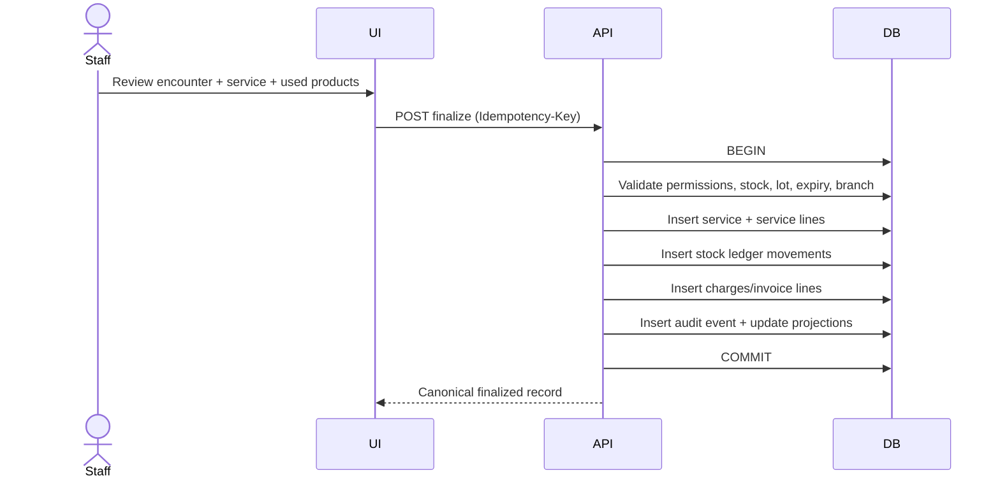

# Domain Workflows and Business Rules

## 1. Owner and patient onboarding
1. Search owner by normalized mobile/email and patient by name/chip number.
2. If possible duplicate is found, user chooses existing owner/patient or explicitly creates a new record.
3. Create/update owner, then one or more linked patients.
4. Capture privacy notice delivery/version, consent where legally required, preferred communication and emergency contact.
5. Create audit event for sensitive edits and merges.

## 2. Appointment → check-in → encounter
1. Book slot with branch, veterinarian, room/resource, appointment type, duration and patient.
2. Validate schedule conflicts and business hours.
3. On arrival, mark arrived; flowboard moves to waiting.
4. Veterinarian starts encounter; appointment is linked, not duplicated.
5. Capture SOAP, vitals, diagnosis and plan; save draft as work progresses.
6. Sign/finalize only after clinician confirmation.

## 3. Service catalog and stock recipe
A service template may define one or more expected consumables. Example used only as test fixture:
- Vaccination service → 1 dose from a vaccine SKU + 1 syringe SKU.
- Wound dressing → configurable gauze and bandage quantities.
- Blood draw → sample tube and needle quantities.

Rules:
- Product mapping is a default recipe, not an immutable instruction. Actual used quantity and lot are recorded.
- If one service consumes multiple lots, create one movement line per lot.
- Unit conversion must be exact and traceable (box → piece, vial → ml only where conversion is configured and clinically appropriate).
- Do not infer dose/volume from a product pack automatically.

## 4. Service finalization atomicity

If any validation/write fails, rollback. A mobile retry with same idempotency key returns the same finalized result, not a duplicate. If the patient visit must be recorded before stock is available, save as pending and do not post partial stock/financial effects.

## 5. Inventory ledger
- Stock on hand = sum of posted movement quantities by product + location + lot. Keep a reconciled projection for fast reads.
- Movement types: RECEIVE, CONSUME_SERVICE, SALE, TRANSFER_OUT, TRANSFER_IN, RETURN, WASTE, EXPIRED, ADJUSTMENT_IN, ADJUSTMENT_OUT, OPENING_BALANCE, REVERSAL.
- Movement records are immutable after posting.
- No direct quantity editing. Stock count creates adjustment with reason, user, time and supporting note.
- Prevent negative stock by default. Override requires explicit permission, reason and audit, and should be disabled for expired/quarantined products.
- Use row-level locks/advisory locks or serializable strategy for competing consumption against the same lot.
- FEFO suggested allocation; FIFO only when expiry not relevant.

## 6. Purchasing and lot receiving
1. Create supplier order (optional) and expected quantities/prices.
2. Receive goods; user records each product, lot, expiry, supplier lot code and storage location.
3. Validate expiry, quarantine and temperature conditions.
4. Post receipt and stock movement in a single transaction.
5. Update purchase payable/supplier statement and cost history.
6. Return to supplier with linked reversal/return movement.

## 7. Prescription and medicine administration
- Prescription is authored and signed by an authorized veterinarian.
- A prescription line has drug/product, strength/form, dose text, route, frequency, duration and quantity. Numeric helper fields must preserve units and source values.
- Prescribed quantity is not automatically assumed to equal stock consumed at clinic. Dispensing and in-clinic administration are distinct events.
- Do not provide AI generated treatment/dose recommendations.

## 8. Vaccine workflow
- Schedule is configurable by clinic and confirmed by vet; no hardcoded universal vaccination schedule.
- Record vaccine, lot, expiry, dose, route/site, date/time, vet and next due date.
- Reminder queue is derived from next_due_date and owner contact preferences.

## 9. Finance workflow
- Finalized services create charges. Payments can be partial and linked to one or more open charges.
- Refund is a separate negative movement/record tied to original payment; do not delete original payment.
- Cash register open/close captures opening amount, cash transactions and counted cash; variance requires explanation.
- Use a document numbering service with branch/year sequence locking.
- Official fiscal invoice integration stays behind provider adapter; local PDF receipt is not represented as official tax invoice.

## 10. Multi-branch
- Every user action executes under active branch context and permission scope.
- Patient/owner can be shared across branches within one clinic; clinical and stock transactions record the originating branch.
- Stock transfer is two-stage with in-transit tracking and receipt confirmation.
- Reports filter by branch and show consolidated totals only to authorized roles.

## 11. Offline workflow
- Mobile can browse a limited cached patient summary and agenda according to role.
- Clinical notes can be captured as drafts offline. Photo uploads are queued.
- Finalization, prescriptions sign-off, payments, stock adjustments and inter-branch transfers require server acknowledgement.
- On sync conflict, preserve both versions and request human resolution; never discard a clinical draft silently.
